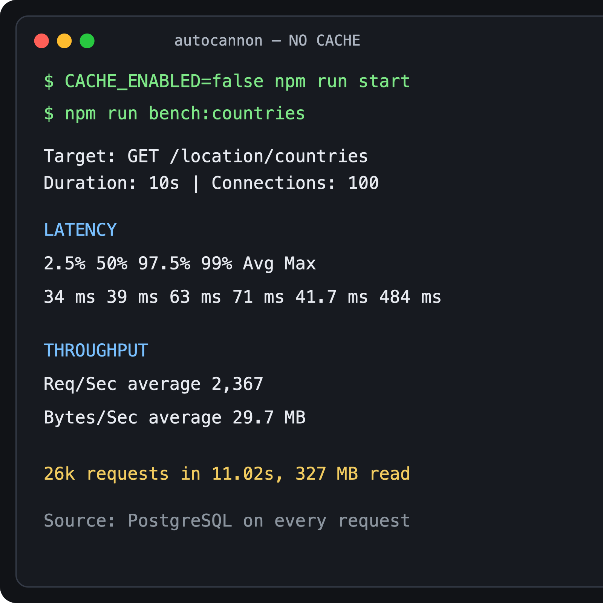
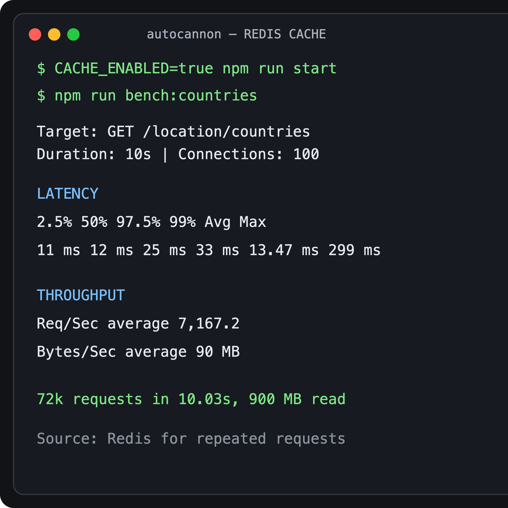

# Project Nest

Навчальний NestJS-проєкт із PostgreSQL, Redis та TypeORM.

## Redis-кешування

Кешування підключено для довідників країн і міст:

- `GET /location/countries`
- `GET /location/countries/:countryId/cities`

Спочатку сервіс шукає дані в Redis. Якщо ключа немає, дані читаються з
PostgreSQL і записуються в Redis на 5 хвилин.

Налаштування в `.env`:

```env
REDIS_HOST=localhost
REDIS_PORT=6379
CACHE_TTL=300
CACHE_ENABLED=true
```

## Autocannon

Тест виконувався для `GET /location/countries`: 100 одночасних підключень,
тривалість 10 секунд.

```bash
npm run bench:countries
```

### Без кешу

- середня затримка: `41.7 ms`
- середня швидкість: `2,367 req/sec`
- виконано приблизно `26,000` запитів



### З Redis-кешем

- середня затримка: `13.47 ms`
- середня швидкість: `7,167.2 req/sec`
- виконано приблизно `72,000` запитів



З Redis кількість запитів за секунду збільшилась приблизно в 3 рази.
